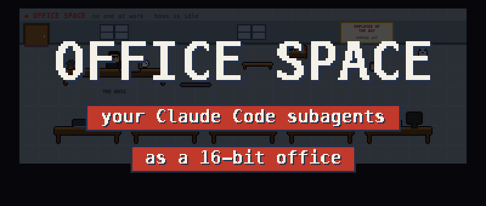
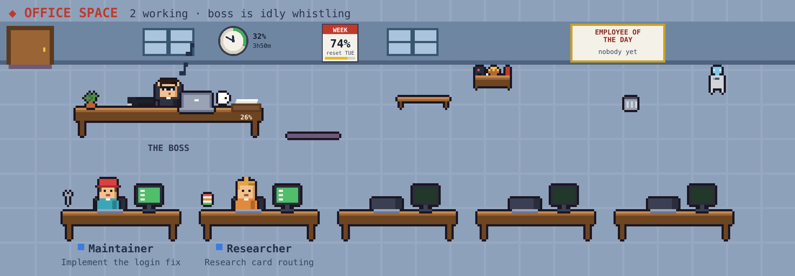
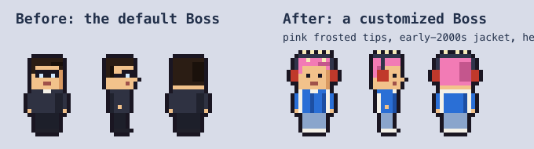
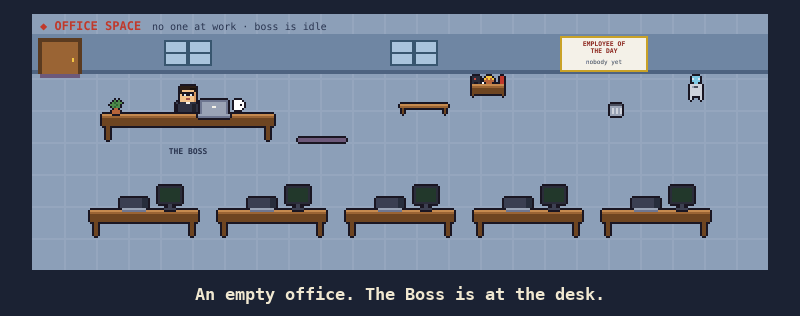
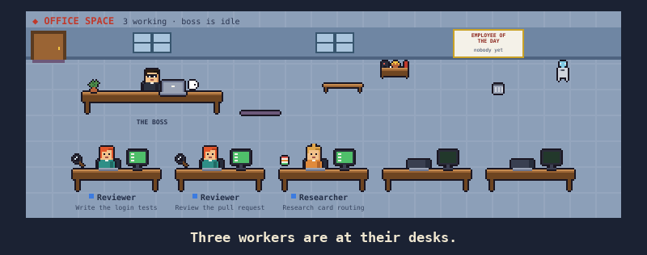
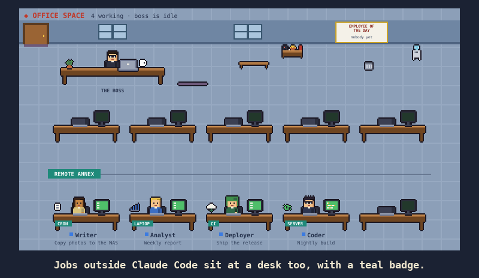
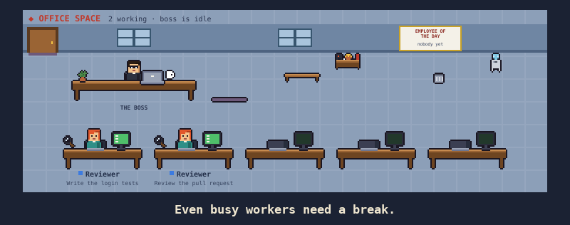
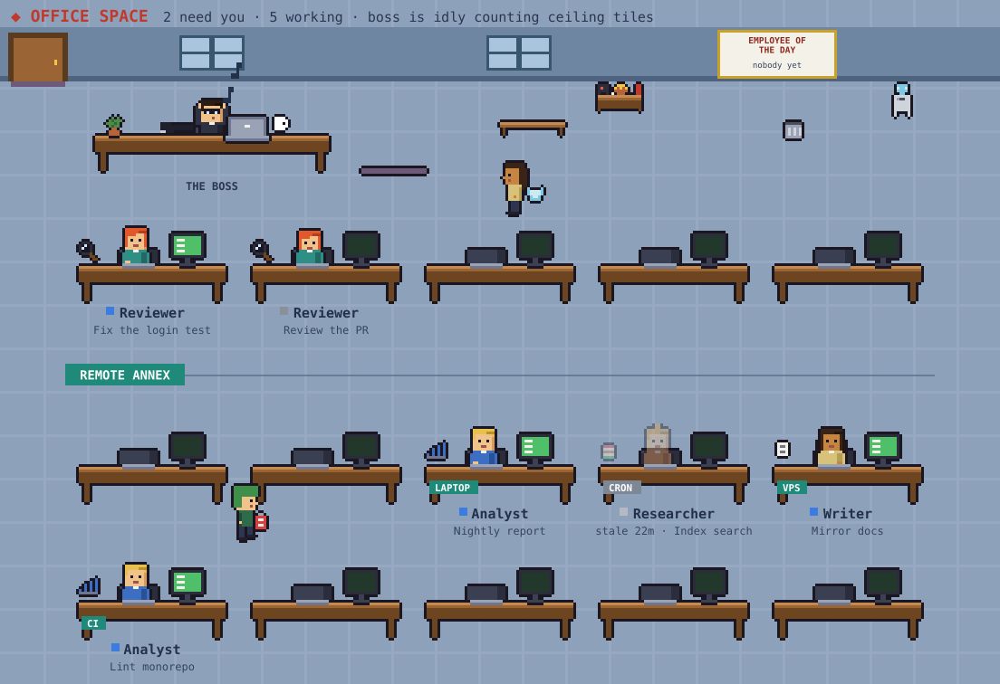
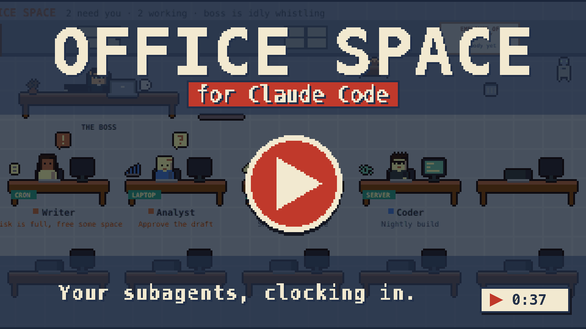

# Office Space



A Claude Code mod that draws your session as a tiny 16-bit office. The main chat is **The Boss**. Each subagent walks in, picks up its assignment, sits at a desk and works. When it finishes, it walks back to hand in the result and leaves. Jobs running outside the session (a cron job, another machine) can sit at a desk too: see [External workers](#external-workers).

## Quick start

**Before you start:** run `claude --version` in a terminal — you need **2.1.29x or newer**. Older versions say "installed" but the office never loads; update Claude Code first.

1. **Install.** In Claude Code in a terminal, run:
   ```
   /plugin install office-space --marketplace rbrtcnkln1/office-space
   ```
   The two settings shown after install (workers folder, staleness) are optional and have defaults.

   **Using the Claude desktop app?** `/plugin` commands aren't available in the desktop Code tab — paste this into a Code tab chat instead and Claude will run the install for you:
   > Install the Office Space mod for Claude Code: check that `claude --version` is 2.1.29x or newer (if older, tell me to update Claude Code instead). Then run `claude plugin marketplace add rbrtcnkln1/office-space` and `claude plugin install office-space@office-space`. When it's done, tell me to run `/reload-plugins` and then `/office-space`.

   Afterwards, restart the app (or run `/reload-plugins`) and type `/office-space`.
2. **Open the office.** Type `/office-space`. Run it again to close the panel. `/office-space-band` shows or hides a small version above the prompt. `/office-space-help` lists every command.
3. **See it with some staff.** With the office open, clone this repo and run the 60-second demo in a terminal:
   ```bash
   git clone https://github.com/rbrtcnkln1/office-space
   bash office-space/examples/demo.sh
   ```
   Four fake workers start, get blocked or need approval, then finish or fail, and the demo cleans up after itself. Or just ask Claude to run a few subagents.

## Commands

| Command | What it does |
| --- | --- |
| `/office-space` | Open or close the Office Space panel |
| `/office-space-band` | Show or hide the small office strip above the prompt |
| `/office-space-help` | List every Office Space command and setting |
| `/office-space-update` | Check GitHub for a newer version and update to it (see [Updating](#updating)) |
| `/office-space-boss` | Change how the Boss looks in plain words or step by step, or `reset` (see [Make the Boss yours](#make-the-boss-yours)) |
| `/office-space-feedback` | Shows the link to report a bug or share an idea, plus your version details to paste in |
| `/office-space-roster` | Who is at work right now (subagents and outside workers), how long they have been at it, and a one-line summary of what each is doing. Uses a little plan usage (see below) |
| `/office-space-recap` | Today's hand-ins, failures, outside workers that needed a person, and the Employee of the Day |
| `/office-space-usage` | Context fill, plan limits with reset times and cost, as plain text. The same figures are drawn in the office (see [Usage in the office](#usage-in-the-office)) |
| `/office-space-workers` | The outside-workers folder, each worker read from it, and every skipped file with a plain reason |

Type `/office-space` in the prompt and the menu lists all of them. The older `/office-space band` still works.

**Which commands use plan usage?** Only `/office-space-roster`. Each run makes one small-model request (Haiku, low effort, a few hundred tokens) that sends every worker's task and recent steps and gets one-line summaries back. It happens outside your conversation, so it adds nothing to your chat context, and the reply is checked before it is shown. If the call fails, times out, is offline, or the reply is unusable, the roster shows each worker's own task text instead and says so. The other commands read local data only. Nothing runs an AI call on its own.

Sample roster:

```
Office roster - 2 at work
  1. Explore - working, 4m on it
     Reading the plugin hooks to find where commands register
  2. Backup bot [cron] - blocked, updated 2m ago
     Task: Copying photos to the NAS

Summaries are written by a small model from each worker's recent steps.
```

### Usage in the office

The office shows usage as objects, using only what your plan reports: context fill is an **in-tray** on the Boss's desk (the paper stack grows, and turns red near full), the 5-hour session limit is a **wall clock** (the ring fills with the share used and the hands show the reset time), and the weekly limit is a **wall calendar**. A figure your plan does not report is not drawn. They refresh when the numbers change, never faster than the office already animates. Turn them off with the `showUsage` setting.



### Settings

The settings are optional and have defaults. Change them in `/plugin` → office-space → configure (or `/config`).

| Setting | Default | What it does |
| --- | --- | --- |
| `workersDir` (External workers folder) | `~/.claude/office-space/workers` | Folder of worker JSON files to show |
| `staleMinutes` (Stale after) | `15` | Minutes without an update before an external worker fades. After 4× that time it leaves |
| `alertOnBlocked` (Alert when a worker needs you) | on | Show a toast when an external worker becomes waiting or blocked. Once per time it starts needing you, never repeated while it stays that way, and not for workers already waiting when the session starts. Off turns the toast off |
| `showUsage` (Show usage in the office) | on | Draw context fill, the session limit and the weekly limit as an in-tray, wall clock and wall calendar. Off hides them; `/office-space-usage` still works |
| `checkForUpdates` (Check for updates daily) | off | Once a day at session start, ask GitHub for the newest version and show one toast if there is one. Off by default |

### Environment variable

`OFFICE_SPACE_WORKERS_DIR` overrides the workers folder. It wins over the setting.

### Scripts

- `examples/office-worker.sh`: writes or updates one worker file safely. Usage: `bash examples/office-worker.sh <id> <working|waiting|blocked|done|failed> "<task>" ["<note>"] ["<scope>"]`
- `examples/demo.sh`: a 60-second demo with fake workers. Usage: `bash examples/demo.sh`

More commands (customize the Boss, your team and the office) are planned — see the [roadmap issues](https://github.com/rbrtcnkln1/office-space/issues).

## Make the Boss yours

Give the Boss a new look, from a small catalog of pixel-art hair styles, hair colors, outfits and accessories:

```
/office-space-boss pink frosted hair, an early-2000s track jacket and headphones
```

- Run it with no words and the Office Space panel walks you through hair style, hair color, outfit and accessory, a few buttons each. Type your own into **Other** and it is read the same way as plain words.
- Whatever you ask for, you see what will change and press **Apply** (or **Cancel**) before anything is saved. The look is kept between sessions. `/office-space-boss reset` brings the default back.
- If you ask for something the catalog does not have yet, such as a jetpack, the reply says so and lists the closest options.
- Reading your words (and "Other") makes one small call to a fast model, so it uses a little of your plan usage. Picking buttons does not. Nothing is added to your conversation.



## Updating

New versions reach you when the `version` in `plugin/.claude-plugin/plugin.json` is bumped on `main`; a change without a bump is not delivered to installed copies.

**Update now.** Any one of these, then run `/reload-plugins`:

- `/office-space-update` inside Claude Code. It reads your installed version, asks GitHub for the latest, and runs `claude plugin update office-space@office-space` for you if there is a newer one. It does nothing if you are already current, and it tells you the manual steps if it is offline or `claude` on your PATH is missing or older than 2.1.290.
- `/plugin` → Marketplaces → office-space → Update
- `claude plugin update office-space` in a terminal

**Update automatically.** Third-party marketplaces do not auto-update by default (only Anthropic's own do), so turn it on once:

1. Type `/plugin` and open the Marketplaces tab.
2. Choose `office-space`.
3. Choose **Enable auto-update**. The screen then reads "Auto-update enabled".

Claude Code then refreshes the marketplace and updates its installed plugins on startup. Run `/reload-plugins` (or restart) to load a new version in a session that was already open. You can turn it off from the same screen (**Disable auto-update**).

**Privacy.** `/office-space-update` makes one request to `raw.githubusercontent.com/rbrtcnkln1/office-space` (the public `plugin.json`) and nothing else. Office Space makes no other network requests unless you turn on the `checkForUpdates` setting, which repeats that one request at most once a day.

## Requirements

A Claude Code version that supports plugin hook modules (2.1.29x or newer); older versions reject the plugin. It works in the terminal and in the desktop app's Code tab.

## FAQ

**Does it use my context or tokens?** Not your context: it only draws UI and answers commands as text, with no skills, agents or prompt text, so it adds nothing to Claude's context. The one exception to "no tokens" is `/office-space-roster`, which spends a little plan usage on one small side request each time you run it (see [Commands](#commands)).

**How do I update?** Type `/office-space-update`, or see [Updating](#updating) for the manual and automatic options.

**How do I uninstall?** `/plugin uninstall office-space`.

## See it in action

Each clip is a short loop drawn by the real renderer (sped up a few times so you don't wait). Regenerate them with [`scripts/media`](scripts/media/README.md).

**Hire day.** Subagents come in through the door, get briefed by the Boss, sit at a desk and start typing.



**Hand-in.** A finished worker walks back to the Boss with the result, and a failed job goes in red. The Employee of the Day sign updates.



**Remote crew.** Jobs outside Claude Code sit in their own row of desks, the remote annex, with a teal badge. Blocked shows a red **!**, waiting a white **?**, and a quiet one fades.



**Break room.** Workers wander off for coffee or push-ups. The Boss kicks back and whistles when there's nothing to do.



## External workers

Work running **outside** the session can show up in the office too: a job on another machine, another CLI, a cron job. Any script can join by writing a small JSON file. The mod only ever reads these files.

### The contract

Put one JSON file per worker in the workers folder:

- Default folder: `~/.claude/office-space/workers/`
- To change it, set the `OFFICE_SPACE_WORKERS_DIR` environment variable, or the plugin's **External workers folder** setting. The environment variable wins.

```json
{
  "id": "nightly-backup",
  "name": "Backup bot",
  "status": "blocked",
  "task": "Copying photos to the NAS",
  "updated": "2026-10-08T14:03:00Z",
  "source": "cron",
  "note": "Disk is full, free some space",
  "url": "https://nas.example.com/jobs/backup"
}
```

| Field | Required | Meaning |
| --- | --- | --- |
| `status` | yes | `working`, `waiting`, `blocked`, `done` or `failed` |
| `id` | no | Unique per worker. Defaults to the file name without `.json` |
| `name` | no | Display name. Defaults to `id` |
| `task` | no | What it's doing. Shown under the desk |
| `updated` | no | ISO 8601 time or epoch milliseconds. Defaults to the file's modified time, which is also used if the time is more than 5 minutes in the future |
| `source` | no | A short label for the desk badge, such as `remote`, `cron` or `laptop`. Defaults to `remote` |
| `note` | no | What a human needs to do. Shown instead of the task while the worker is waiting or blocked |
| `url` | no | An `http://` or `https://` address (up to 300 characters) with more detail, such as the job's page. Shown as text, with a copy button, when you press the waiting or blocked worker. Never opened by the mod. Any other kind of address is ignored, and the worker still shows |
| `scope` | no | A folder path or an array of them, absolute (`~` means your home folder). The worker shows only in sessions whose working folder is that folder or inside it. Without `scope` it shows everywhere. A malformed `scope` skips the worker |

### Limiting a worker to a project

The workers folder is global to the machine, so by default every worker shows up in every Claude Code session, including unrelated projects. Add `scope` to keep a worker private to the folders it belongs to:

```json
{ "id": "nightly-backup", "status": "working", "scope": ["~/projects/photos", "/srv/backups"] }
```

Folders are compared as real paths (symlinks resolved) on a folder boundary, so `/a/b` matches `/a/b` and `/a/b/c` but not `/a/bc`. If the session's working folder cannot be read, only workers without a `scope` are shown.

### The remote annex

External workers never mix with your subagents. They sit in their own row of desks, the **remote annex**, under a teal sign below the main floor. The annex only exists while someone remote is in the office: with no external workers the office looks exactly as before. It adds one spare desk, grows a row at a time as more arrive (as wide as the main floor), and shrinks back after they leave, never moving a desk someone is sitting at.



### Reading a note and alerts

- **Press a worker that needs you.** Every waiting or blocked worker gets a button under the office (in the panel and in the band, on the desktop and in the terminal). Press it, or in the panel press its number key, to read its `note` and its `url`. Press it again to hide it. A worker with no note shows its task instead.
- **A toast when one starts needing you.** One toast each time a worker moves into waiting or blocked, even with the office closed. It does not repeat while the worker stays waiting or blocked, and it does not fire for workers that were already waiting when the session started. Turn it off with the **Alert when a worker needs you** setting (`alertOnBlocked`). It is a toast only, with no sound.

### How workers appear

- **working**: walks in and goes straight to a desk in the annex with no briefing from the Boss, since it already has its work. A teal badge on the desk shows its `source`.
- **waiting**: a white **?** bubble stays over the worker's head, because a person is needed.
- **blocked**: a red **!** bubble stays over the worker's head. The summary line counts these as "N needs you".
- **done** or **failed**: hands the result to the Boss (a failed result is red) and walks out.
- **Stale**: after 15 minutes without an update, the worker fades and its desk shows `stale Nm`. After 4× that time (1 hour by default), it walks out. Change the time limit with the **Stale after (minutes)** setting.
- **File deleted**: the worker quietly walks out.

The folder is checked every 5 seconds. Only files that changed since the last check are re-read. The mod skips a file without crashing if it is malformed, unreadable, bigger than 64 KB, hidden (starts with `.`), not `.json`, or has a malformed `scope`. It shows at most 40 external workers.

### Example writer

[`examples/office-worker.sh`](examples/office-worker.sh) writes one worker file. It writes to a hidden temp name and renames it, so the mod never reads a half-written file, and it escapes text with `jq` when available (with a plain fallback):

```bash
bash examples/office-worker.sh nightly-backup blocked "Copying photos" "Disk is full, free some space"
bash examples/office-worker.sh nightly-backup done "Copying photos"
bash examples/office-worker.sh nightly-backup working "Copying photos" "" ~/projects/photos   # only shown inside that folder
```

```bash
bash examples/office-worker.sh deploy waiting "Ship 4.2" "Approve in CI" "" "https://ci.example.com/runs/42"   # note and url, shown when pressed
```

The scope can also come from the `OFFICE_SPACE_SCOPE` environment variable, and the url from `OFFICE_SPACE_URL`. The script refuses a url that is not `http://` or `https://`. Usage line, for reference:

```
office-worker.sh <id> <status> "<task>" ["<note>"] ["<scope>"] ["<url>"]
```

To report from another machine, sync or mount its status folder into the workers folder (for example with `rsync` or a shared drive). [`examples/demo.sh`](examples/demo.sh) stages four workers for about a minute.

## Development

See [CONTRIBUTING.md](CONTRIBUTING.md). Quick checks:

```bash
claude plugin validate .
claude plugin validate plugin
bash scripts/test.sh
```

## Feedback and ideas

Found a bug or have an idea? Run `/office-space-feedback` or open an issue: https://github.com/rbrtcnkln1/office-space/issues/new/choose. You'll need a free GitHub account. Nothing is sent automatically.

## Buy me a coffee

Office Space is free and always will be. If it made your day a little more fun, you can tip the staff a coffee:

[](https://buy.stripe.com/bJeeVd30A2o86zEahZ18c00)

## License

MIT — see [LICENSE](LICENSE).

## Watch the teaser

[](https://github.com/rbrtcnkln1/office-space/releases/download/v0.8.1/office-space-teaser.mp4)

https://github.com/user-attachments/assets/13b7944a-4ba9-4aa3-b2d8-5ad59e323084
