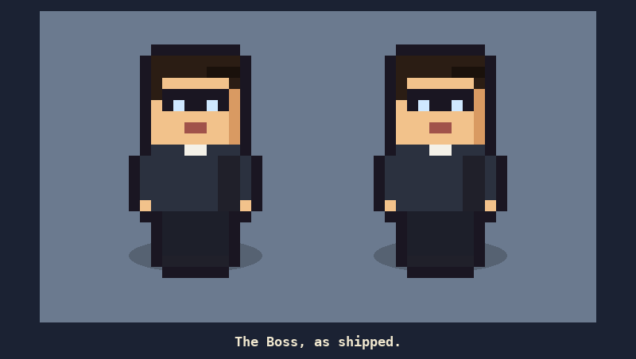
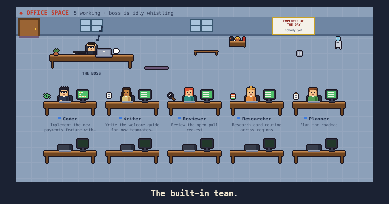
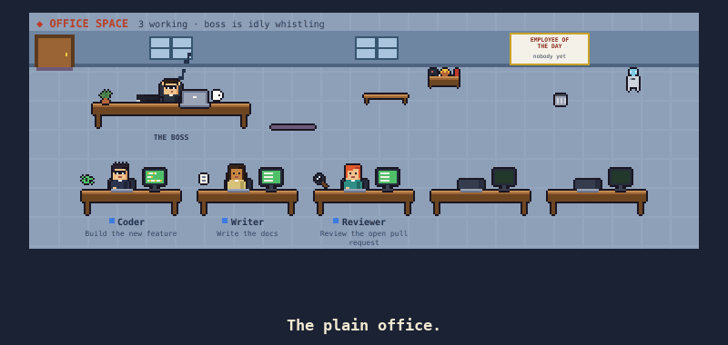
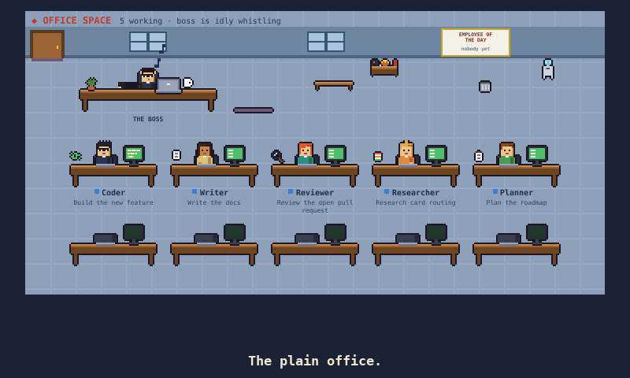
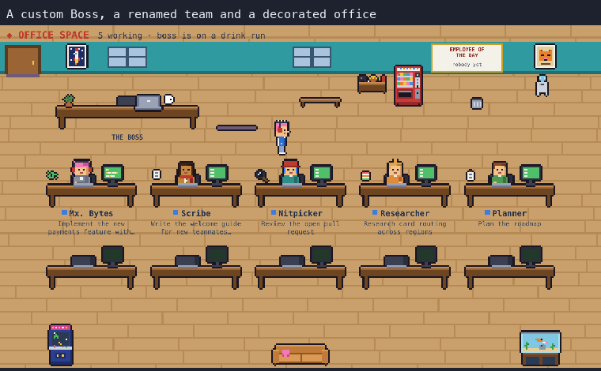
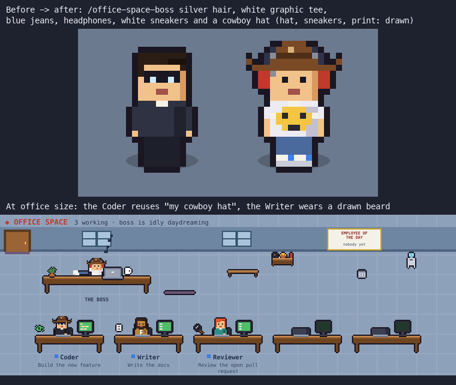
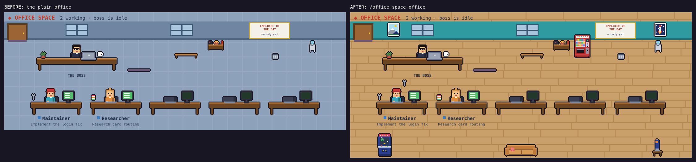
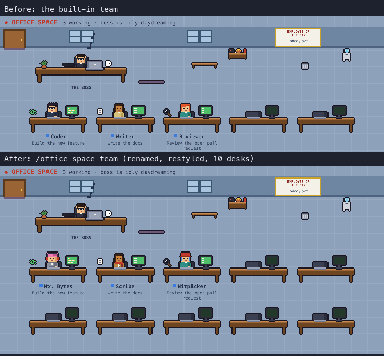
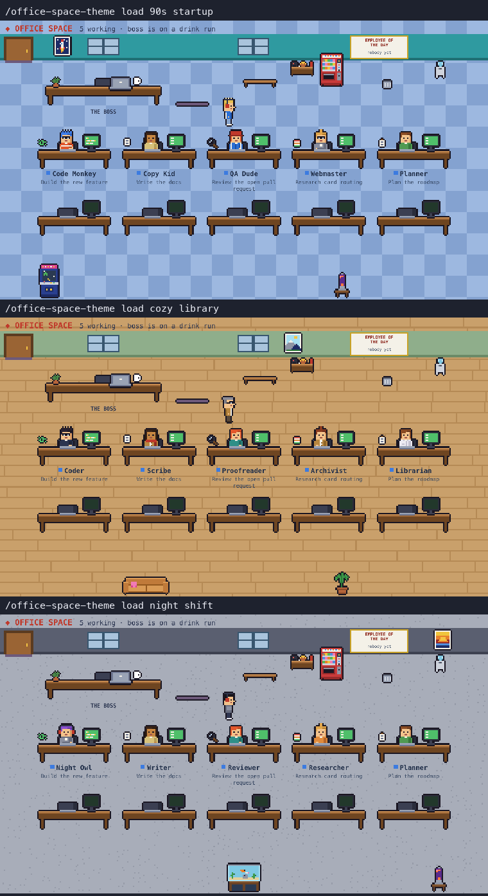

# Office Space


A Claude Code mod that draws your session as a tiny 16-bit office. The main chat is **The Boss**. Each subagent walks in, picks up its assignment, sits at a desk and works. When it finishes, it walks back to hand in the result and leaves. Jobs running outside the session (a cron job, another machine) can sit at a desk too: see [External workers](#external-workers).

## Quick start

**Before you start:** run `claude --version` in a terminal — you need **2.1.29x or newer**. Older versions say "installed" but the office never loads; update Claude Code first.

1. **Install.** In Claude Code in a terminal, run:
   ```
   /plugin install office-space --marketplace rbrtcnkln1/office-space
   ```
   The two settings shown after install (workers folder, staleness) are optional and have defaults.

   **Using the Claude desktop app?** `/plugin` commands aren't available in the desktop Code tab — paste this into a Code tab chat instead and Claude will run the install for you:
   > Install the Office Space mod for Claude Code: check that `claude --version` is 2.1.29x or newer (if older, tell me to update Claude Code instead). Then run `claude plugin marketplace add rbrtcnkln1/office-space` and `claude plugin install office-space@office-space`. When it's done, tell me to run `/reload-plugins` and then `/office-space`.

   Afterwards, restart the app (or run `/reload-plugins`) and type `/office-space`.
2. **Open the office.** Type `/office-space`. Run it again to close the panel. `/office-space-band` shows or hides a small version above the prompt. `/office-space-help` lists every command. Then [make it yours](#make-it-yours).
3. **See it with some staff.** With the office open, clone this repo and run the 60-second demo in a terminal:
   ```bash
   git clone https://github.com/rbrtcnkln1/office-space
   bash office-space/examples/demo.sh
   ```
   Four fake workers start, get blocked or need approval, then finish or fail, and the demo cleans up after itself. Or just ask Claude to run a few subagents.

## Make it yours

Change how the office looks. Every command below works two ways: **say what you want in plain words**, or **run it with no words and pick with buttons in the panel**. Either way you see what will change and press **Apply** before anything is saved, and the default office looks exactly as it always has until you change something. Looks are kept between sessions.

**The Boss.** New hair, outfit, colors and accessories.

```
/office-space-boss pink frosted hair, an early-2000s track jacket and headphones
```



**The team.** Rename the roles, restyle each one and choose how many desks the room starts with. Long tasks wrap onto two lines under the desk.

```
/office-space-team call the Coder "Mx. Bytes" and give the Writer a cardigan and a scarf
```



**The office.** Wall colors, floors and furniture: a vending machine (workers walk over for a snack), arcade cabinet, couch, fern, cactus, lava lamp, fish tank and posters.

```
/office-space-office teal walls, a vending machine and an arcade cabinet
```



**Themes.** Your Boss, team and office saved as one small file you can keep, share or swap. Three come built in: 90s startup, cozy library and night shift. Themes never use AI.

```
/office-space-theme load night shift
/office-space-theme save my-office
```



**Colors.** Any outfit takes a top and a trouser color (white, black, red, teal, navy, pink, denim and more), and hair has its own colors. Just say it: `/office-space-boss a white tee and blue jeans`.

**AI-drawn parts.** Ask for something the catalog does not have, like a cowboy hat, sneakers, a beard or a shirt print. The panel offers **Draw it**: an AI draws it as a tiny pixel grid, shows you the result, and you **Apply**, **Retry** or **Cancel**. Parts you keep are saved and can be reused on any role (`/office-space-team give the Coder my cowboy hat`). See [Drawn parts](#drawn-parts).

**What costs plan usage.** Pressing buttons, `list`, `reset`, `remove` and themes are free. Reading your words makes one small call to a fast model, a little usage. **Draw it** uses a more capable model, so a bit more. Nothing is ever added to your chat context.



## Commands

There are 13. Type `/office-space` and the menu lists them all (`/office-space-help` too).

**Office**

| Command | What it does |
| --- | --- |
| `/office-space` | Open or close the Office Space panel |
| `/office-space-band` | Show or hide the small office strip above the prompt |

**Info**

| Command | What it does |
| --- | --- |
| `/office-space-roster` | Who is at work right now (subagents and outside workers), how long they have been at it, and a one-line summary of what each is doing. Uses a little plan usage |
| `/office-space-recap` | Today's hand-ins, failures, outside workers that needed a person, and the Employee of the Day |
| `/office-space-usage` | Context fill, plan limits with reset times and cost, as plain text. The same figures are drawn in the office (see [Usage in the office](#usage-in-the-office)) |
| `/office-space-workers` | The outside-workers folder, each worker read from it, and every skipped file with a plain reason |

**Make it yours**

| Command | What it does |
| --- | --- |
| `/office-space-boss` | Change how the Boss looks, in words or with buttons; `parts` lists your drawn parts; `reset` (see [Make the Boss yours](#make-the-boss-yours)) |
| `/office-space-team` | Rename roles, restyle them and set the starting desk count; `reset` or `reset coder` (see [Make the team yours](#make-the-team-yours)) |
| `/office-space-office` | Wall color, floor and furniture; `list`, `remove <piece>` and `reset` (see [Decorate the office](#decorate-the-office)) |
| `/office-space-theme` | Save your look as a file, load one or a built-in preset, `list`, `reset` (see [Themes](#themes)) |

**Help and updates**

| Command | What it does |
| --- | --- |
| `/office-space-help` | List every command and setting |
| `/office-space-update` | Check GitHub for a newer version and update to it (see [Updating](#updating)) |
| `/office-space-feedback` | The link to report a bug or share an idea, plus your version details to paste in |

The older `/office-space band` still works.

**Which commands use plan usage?** `/office-space-roster`, and `/office-space-boss`, `/office-space-team` and `/office-space-office` when you describe something in words. Buttons, `list`, `parts`, `remove` and `reset` use none, and `/office-space-theme` never does. Pressing **Draw it** makes one call to a more capable model (Sonnet, low effort, a capped reply), so it uses a bit more than reading words. Each roster run makes one small-model request (Haiku, low effort, a few hundred tokens) that sends every worker's task and recent steps and gets one-line summaries back. These happen outside your conversation, so nothing is added to your chat context, and replies are checked before they are shown. If a call fails, times out, is offline, or the reply is unusable, you get a plain fallback and a note saying so (the roster shows each worker's own task text). The other commands read local data only. Nothing runs an AI call on its own.

Sample roster:

```
Office roster - 2 at work
  1. Explore - working, 4m on it
     Reading the plugin hooks to find where commands register
  2. Backup bot [cron] - blocked, updated 2m ago
     Task: Copying photos to the NAS

Summaries are written by a small model from each worker's recent steps.
```

### Usage in the office

The office shows usage as objects, using only what your plan reports: context fill is an **in-tray** on the Boss's desk (the paper stack grows, and turns red near full), the 5-hour session limit is a **wall clock** (the ring fills with the share used and the hands show the reset time), and the weekly limit is a **wall calendar**. A figure your plan does not report is not drawn. They refresh when the numbers change, never faster than the office already animates. Turn them off with the `showUsage` setting.


### Settings

There are five settings, all optional with defaults. Change them in `/plugin` → office-space → configure (or `/config`). Your Boss, team, office and drawn parts are not settings: they are saved by their commands (themes live as files in `~/.claude/office-space/themes/`).

| Setting | Default | What it does |
| --- | --- | --- |
| `workersDir` (External workers folder) | `~/.claude/office-space/workers` | Folder of worker JSON files to show |
| `staleMinutes` (Stale after) | `15` | Minutes without an update before an external worker fades. After 4× that time it leaves |
| `alertOnBlocked` (Alert when a worker needs you) | on | Show a toast when an external worker becomes waiting or blocked. Once per time it starts needing you, never repeated while it stays that way, and not for workers already waiting when the session starts. Off turns the toast off |
| `showUsage` (Show usage in the office) | on | Draw context fill, the session limit and the weekly limit as an in-tray, wall clock and wall calendar. Off hides them; `/office-space-usage` still works |
| `checkForUpdates` (Check for updates daily) | off | Once a day at session start, ask GitHub for the newest version and show one toast if there is one. Off by default |

### Environment variable

`OFFICE_SPACE_WORKERS_DIR` overrides the workers folder. It wins over the setting.

### Scripts

- `examples/office-worker.sh`: writes or updates one worker file safely. Usage: `bash examples/office-worker.sh <id> <working|waiting|blocked|done|failed> "<task>" ["<note>"] ["<scope>"]`
- `examples/demo.sh`: a 60-second demo with fake workers. Usage: `bash examples/demo.sh`

Ideas and plans live in the [issues](https://github.com/rbrtcnkln1/office-space/issues).

## Make the Boss yours

Give the Boss a new look, from a small catalog of pixel-art hair styles, hair colors, outfits, clothing colors and accessories:

```
/office-space-boss pink frosted hair, an early-2000s track jacket and headphones
/office-space-boss silver hair, a white tee and blue jeans
```

- Run it with no words and the Office Space panel walks you through hair style, hair color, outfit, top color, trouser color (skipped for a suit, which is one piece) and accessory, a few buttons each. Type your own into **Other** and it is read the same way as plain words.
- Clothing colors: white, black, gray, red, orange, yellow, green, teal, blue, navy, purple, pink, brown, tan and denim, for the top and the bottom of any outfit. Leave one unset and the outfit keeps its own color.
- Whatever you ask for, you see what will change and press **Apply** (or **Cancel**) before anything is saved. The look is kept between sessions. `/office-space-boss reset` brings the default back.
- If you ask for something the catalog does not have yet, the reply says so. When it is something worn or held (a cowboy hat, sneakers, a print on the shirt, a beard, wings), the panel also offers **Draw it** (see [Drawn parts](#drawn-parts)).
- Reading your words (and "Other") makes one small call to a fast model, so it uses a little of your plan usage. Picking buttons does not. Nothing is added to your conversation.


### Drawn parts

When the catalog has nothing for what you asked, press **Draw it** and the AI draws it as a tiny pixel grid in the sprite's own format: a hat, a face accessory (beard, sunglasses), a shirt print, shoes, something held, or something on the back (wings, a cape).

- The panel shows the character before and after. **Apply** keeps it, **Retry** draws again, **Cancel** drops it. The look itself is still only saved when you press the final **Apply**.
- Drawing uses a more capable model than reading words (one call per drawing, a capped reply), so it uses **a bit more plan usage**. The catalog path stays free for buttons and instant.
- Every drawing is checked before it is shown: exact size for its slot, only the allowed palette letters, not empty and not too full, and a hat may not cover the eyes. A drawing that breaks a rule is retried once automatically; if it fails again, you get Retry and Cancel. A drawing is data only, never run.
- Kept parts are yours to reuse: `/office-space-team give the Coder my cowboy hat`, `/office-space-boss wear my cowboy hat`. `/office-space-boss parts` lists them (up to 24) and `/office-space-boss parts delete cowboy hat` removes one (and takes it off whoever wears it). Themes carry the drawn parts their looks wear.



## Decorate the office

Pick wall colors, floors and furniture from a small catalog of pixel-art pieces:

```
/office-space-office teal walls, a vending machine and an arcade cabinet
```

- **Catalog:** 9 wall colors, 8 floors (tiles, checkerboards, wood planks and carpets), and a vending machine, arcade cabinet, couch, potted fern, cactus, lava lamp, fish tank and 4 posters. `/office-space-office list` shows them all.
- **Where things go:** posters hang on the back wall, the vending machine has its own spot in the break area, and everything else stands along a strip added under the last row of desks, so nothing blocks an aisle, a desk, the door or the break area.
- **The vending machine works:** workers walk over on breaks and come back with a soda, a donut or a cookie.
- Run it with no words and the panel asks what to change (add furniture, wall color, floor, or remove a piece), then which one, then where. **Other** takes your own words, read the same way as a plain-words command. You see what will change and press **Apply** (or **Cancel**) before anything is saved; it is kept between sessions.
- `/office-space-office remove couch` takes a piece out, `/office-space-office reset` restores the plain office. If you ask for something the catalog does not have, such as a hot tub, the reply says so and lists the closest options.
- Reading your words (and "Other") makes one small call to a fast model, so it uses a little of your plan usage. Buttons, `list`, `remove <piece>` and `reset` do not. Nothing is added to your conversation.



## Make the team yours

Rename the roles, restyle them from the same catalog as the Boss, and choose how many desks the office starts with:

```
/office-space-team call the Coder "Mx. Bytes" and give the Writer a cardigan and a scarf
/office-space-team start with ten desks
```

- Run it with no words and the panel asks what to change (a team member or the desk count), which role, which part (title, hair, outfit and its colors, accessory), then a few buttons. **Other** takes a role name, a new title, a number, or words read like plain ones.
- Drawn parts work here too: ask for something the catalog lacks and press **Draw it**, or reuse one you kept (`give the Coder my cowboy hat`, no AI call). See [Drawn parts](#drawn-parts).
- You see what will change and press **Apply** (or **Cancel**) before anything is saved. Kept between sessions. `/office-space-team reset` restores every default and `/office-space-team reset coder` restores one role.
- Titles are your own text: control characters are removed, they are cut at 14 characters and always drawn as plain text. A part you do not change keeps the role's built-in look. The Boss has its own command.
- Desks: 5 to 15, in rows of five (5 is the room's smallest layout, so you can only add). It sets the starting size; the room still grows when more workers arrive and never takes a desk away from someone sitting at it. Mapping task words to roles is not part of this command yet.
- Reading your words (and "Other") makes one small call to a fast model, so it uses a little plan usage. Picking buttons does not. Nothing is added to your conversation.



## Themes

A theme is your Boss look, team and office in one small file you can keep, share or swap.

```
/office-space-theme save night-owls         # writes ~/.claude/office-space/themes/night-owls.json
/office-space-theme load night-owls         # a saved theme, by name
/office-space-theme load ~/Downloads/x.json # or by path
/office-space-theme load night shift        # a built-in preset
/office-space-theme list
/office-space-theme reset                   # every default back
```

- Loading always shows what will change and waits for **Apply**. Nothing happens on its own.
- Three presets ship with the mod: **90s startup**, **cozy library** and **night shift**. They use only catalog parts.
- A theme file is **data only**. It is checked key by key against the catalog and the team rules: an unknown key, an unknown part, a bad title, a drawn part that breaks the drawing rules (or is named but not in the file), a file over 16 KB or anything that is not valid JSON refuses the whole file, and nothing in it is ever run. Older theme files (without clothing colors or drawn parts) still load. Only the sections you saved are written; a section a file leaves out is left alone when it loads.
- Themes use no AI and no plan usage.

Format (version 1):

```json
{
  "format": "office-space-theme",
  "version": 1,
  "name": "night owls",
  "boss": { "hair": "short", "hairColor": "black", "outfit": "hoodie", "accessory": "headphones", "bottom": "black" },
  "team": {
    "titles": { "coder": "Night Owl" },
    "looks": { "coder": { "hairColor": "purple", "outfit": "hoodie", "top": "navy", "parts": { "hat": "cowboy-hat-fk5yka" } } },
    "desks": 10
  },
  "office": {
    "wall": "charcoal",
    "floor": "gray-carpet",
    "items": { "break": "vending-machine", "bottom-3": "fish-tank" }
  },
  "parts": [
    { "id": "cowboy-hat-fk5yka", "name": "cowboy hat", "slot": "hat",
      "rows": ["......BBBB......", ".....BBeBBB.....", ".....bbbbbb.....", "B...BBBBBBBB...B", ".BBBBBBBBBBBBBB.", "................", "................"] }
  ]
}
```

`top`, `bottom` and `parts` are optional. Each drawn part is a grid of palette letters at its slot's exact size (hat 16x7, face 10x7, shirt print 6x4, shoes 3x2, held item 5x6, back 16x12); `.` is transparent.

All sections but `format`, `version` and `name` are optional. `boss` needs all four parts; `looks` can name any of `hair`, `hairColor`, `outfit`, `accessory`. `office` is the same decor `/office-space-office` saves: a `wall` and `floor` id and `items` mapping a spot (`break`, `wall-door`, `wall-table`, `wall-cooler`, `bottom-1` to `bottom-5`) to a piece that fits there; a part left out is the plain default. Role ids are `planner`, `researcher`, `coder`, `writer`, `analyst`, `maintainer`, `deployer`, `reviewer`, `skeptic`, `optimist`.



## Updating

New versions reach you when the `version` in `plugin/.claude-plugin/plugin.json` is bumped on `main`; a change without a bump is not delivered to installed copies.

**Update now.** Any one of these, then run `/reload-plugins`:

- `/office-space-update` inside Claude Code. It reads your installed version, asks GitHub for the latest, and runs `claude plugin update office-space@office-space` for you if there is a newer one. It does nothing if you are already current, and it tells you the manual steps if it is offline or `claude` on your PATH is missing or older than 2.1.290.
- `/plugin` → Marketplaces → office-space → Update
- `claude plugin update office-space` in a terminal

**Update automatically.** Third-party marketplaces do not auto-update by default (only Anthropic's own do), so turn it on once:

1. Type `/plugin` and open the Marketplaces tab.
2. Choose `office-space`.
3. Choose **Enable auto-update**. The screen then reads "Auto-update enabled".

Claude Code then refreshes the marketplace and updates its installed plugins on startup. Run `/reload-plugins` (or restart) to load a new version in a session that was already open. You can turn it off from the same screen (**Disable auto-update**).

**Privacy.** `/office-space-update` makes one request to `raw.githubusercontent.com/rbrtcnkln1/office-space` (the public `plugin.json`) and nothing else. Office Space makes no other network requests unless you turn on the `checkForUpdates` setting, which repeats that one request at most once a day.

## Requirements

A Claude Code version that supports plugin hook modules (2.1.29x or newer); older versions reject the plugin. It works in the terminal and in the desktop app's Code tab.

## FAQ

**Does it use my context or tokens?** Not your context: it only draws UI and answers commands as text, with no skills, agents or prompt text, so it adds nothing to Claude's context. The exceptions to "no tokens" are `/office-space-roster`, and `/office-space-boss`, `/office-space-team` and `/office-space-office` with words, which spend a little plan usage on one small side request each time, and **Draw it**, which uses a bit more (see [Make it yours](#make-it-yours)).

**Do I need a Claude plan to customize?** Only for plain words and **Draw it**. Buttons work with nothing extra, and the default office needs nothing.

**Can I share my look?** Yes: `/office-space-theme save my-office` writes one small file you can send to a friend, and they `load` it by path. Theme files are data only and are checked before anything is applied.

**Something looks wrong, how do I put it back?** `/office-space-theme reset` restores every default, or reset one part: `/office-space-boss reset`, `/office-space-team reset`, `/office-space-office reset`.

**How do I update?** Type `/office-space-update`, or see [Updating](#updating) for the manual and automatic options.

**How do I uninstall?** `/plugin uninstall office-space`.

## See it in action

Each clip is a short loop drawn by the real renderer (sped up a few times so you don't wait). Regenerate them with [`scripts/media`](scripts/media/README.md).

**Hire day.** Subagents come in through the door, get briefed by the Boss, sit at a desk and start typing.


**Hand-in.** A finished worker walks back to the Boss with the result, and a failed job goes in red. The Employee of the Day sign updates.


**Remote crew.** Jobs outside Claude Code sit in their own row of desks, the remote annex, with a teal badge. Blocked shows a red **!**, waiting a white **?**, and a quiet one fades.


**Break room.** Workers wander off for coffee or push-ups. The Boss kicks back and whistles when there's nothing to do.


## External workers

Work running **outside** the session can show up in the office too: a job on another machine, another CLI, a cron job. Any script can join by writing a small JSON file. The mod only ever reads these files.

### The contract

Put one JSON file per worker in the workers folder:

- Default folder: `~/.claude/office-space/workers/`
- To change it, set the `OFFICE_SPACE_WORKERS_DIR` environment variable, or the plugin's **External workers folder** setting. The environment variable wins.

```json
{
  "id": "nightly-backup",
  "name": "Backup bot",
  "status": "blocked",
  "task": "Copying photos to the NAS",
  "updated": "2026-10-08T14:03:00Z",
  "source": "cron",
  "note": "Disk is full, free some space",
  "url": "https://nas.example.com/jobs/backup"
}
```

| Field | Required | Meaning |
| --- | --- | --- |
| `status` | yes | `working`, `waiting`, `blocked`, `done` or `failed` |
| `id` | no | Unique per worker. Defaults to the file name without `.json` |
| `name` | no | Display name. Defaults to `id` |
| `task` | no | What it's doing. Shown under the desk |
| `updated` | no | ISO 8601 time or epoch milliseconds. Defaults to the file's modified time, which is also used if the time is more than 5 minutes in the future |
| `source` | no | A short label for the desk badge, such as `remote`, `cron` or `laptop`. Defaults to `remote` |
| `note` | no | What a human needs to do. Shown instead of the task while the worker is waiting or blocked |
| `url` | no | An `http://` or `https://` address (up to 300 characters) with more detail, such as the job's page. Shown as text, with a copy button, when you press the waiting or blocked worker. Never opened by the mod. Any other kind of address is ignored, and the worker still shows |
| `scope` | no | A folder path or an array of them, absolute (`~` means your home folder). The worker shows only in sessions whose working folder is that folder or inside it. Without `scope` it shows everywhere. A malformed `scope` skips the worker |

### Limiting a worker to a project

The workers folder is global to the machine, so by default every worker shows up in every Claude Code session, including unrelated projects. Add `scope` to keep a worker private to the folders it belongs to:

```json
{ "id": "nightly-backup", "status": "working", "scope": ["~/projects/photos", "/srv/backups"] }
```

Folders are compared as real paths (symlinks resolved) on a folder boundary, so `/a/b` matches `/a/b` and `/a/b/c` but not `/a/bc`. If the session's working folder cannot be read, only workers without a `scope` are shown.

### The remote annex

External workers never mix with your subagents. They sit in their own row of desks, the **remote annex**, under a teal sign below the main floor. The annex only exists while someone remote is in the office: with no external workers the office looks exactly as before. It adds one spare desk, grows a row at a time as more arrive (as wide as the main floor), and shrinks back after they leave, never moving a desk someone is sitting at.


### Reading a note and alerts

- **Press a worker that needs you.** Every waiting or blocked worker gets a button under the office (in the panel and in the band, on the desktop and in the terminal). Press it, or in the panel press its number key, to read its `note` and its `url`. Press it again to hide it. A worker with no note shows its task instead.
- **A toast when one starts needing you.** One toast each time a worker moves into waiting or blocked, even with the office closed. It does not repeat while the worker stays waiting or blocked, and it does not fire for workers that were already waiting when the session started. Turn it off with the **Alert when a worker needs you** setting (`alertOnBlocked`). It is a toast only, with no sound.

### How workers appear

- **working**: walks in and goes straight to a desk in the annex with no briefing from the Boss, since it already has its work. A teal badge on the desk shows its `source`.
- **waiting**: a white **?** bubble stays over the worker's head, because a person is needed.
- **blocked**: a red **!** bubble stays over the worker's head. The summary line counts these as "N needs you".
- **done** or **failed**: hands the result to the Boss (a failed result is red) and walks out.
- **Stale**: after 15 minutes without an update, the worker fades and its desk shows `stale Nm`. After 4× that time (1 hour by default), it walks out. Change the time limit with the **Stale after (minutes)** setting.
- **File deleted**: the worker quietly walks out.

The folder is checked every 5 seconds. Only files that changed since the last check are re-read. The mod skips a file without crashing if it is malformed, unreadable, bigger than 64 KB, hidden (starts with `.`), not `.json`, or has a malformed `scope`. It shows at most 40 external workers.

### Example writer

[`examples/office-worker.sh`](examples/office-worker.sh) writes one worker file. It writes to a hidden temp name and renames it, so the mod never reads a half-written file, and it escapes text with `jq` when available (with a plain fallback):

```bash
bash examples/office-worker.sh nightly-backup blocked "Copying photos" "Disk is full, free some space"
bash examples/office-worker.sh nightly-backup done "Copying photos"
bash examples/office-worker.sh nightly-backup working "Copying photos" "" ~/projects/photos   # only shown inside that folder
```

```bash
bash examples/office-worker.sh deploy waiting "Ship 4.2" "Approve in CI" "" "https://ci.example.com/runs/42"   # note and url, shown when pressed
```

The scope can also come from the `OFFICE_SPACE_SCOPE` environment variable, and the url from `OFFICE_SPACE_URL`. The script refuses a url that is not `http://` or `https://`. Usage line, for reference:

```
office-worker.sh <id> <status> "<task>" ["<note>"] ["<scope>"] ["<url>"]
```

To report from another machine, sync or mount its status folder into the workers folder (for example with `rsync` or a shared drive). [`examples/demo.sh`](examples/demo.sh) stages four workers for about a minute.

## Development

See [CONTRIBUTING.md](CONTRIBUTING.md). Quick checks:

```bash
claude plugin validate .
claude plugin validate plugin
bash scripts/test.sh
```

## Feedback and ideas

Found a bug or have an idea? Run `/office-space-feedback` or open an issue: https://github.com/rbrtcnkln1/office-space/issues/new/choose. You'll need a free GitHub account. Nothing is sent automatically.

## Buy me a coffee

Office Space is free and always will be. If it made your day a little more fun, you can tip the staff a coffee:

[](https://buy.stripe.com/bJeeVd30A2o86zEahZ18c00)

## License

MIT — see [LICENSE](LICENSE).

## Watch the teaser

[](https://github.com/rbrtcnkln1/office-space/releases/download/v0.8.1/office-space-teaser.mp4)

https://github.com/user-attachments/assets/13b7944a-4ba9-4aa3-b2d8-5ad59e323084
